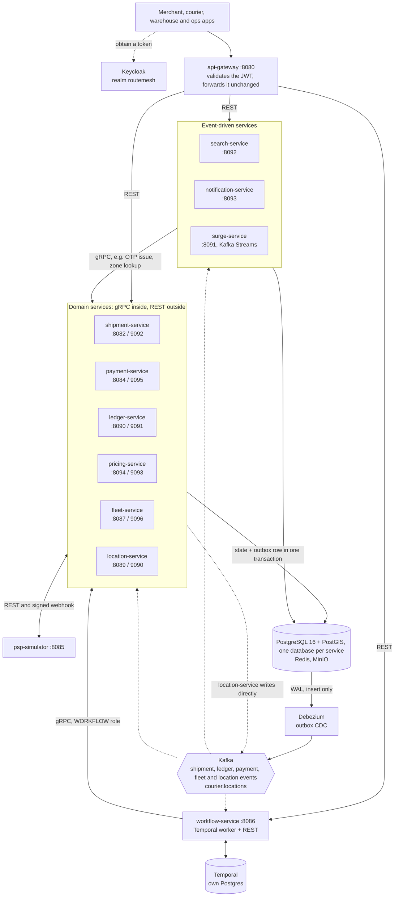
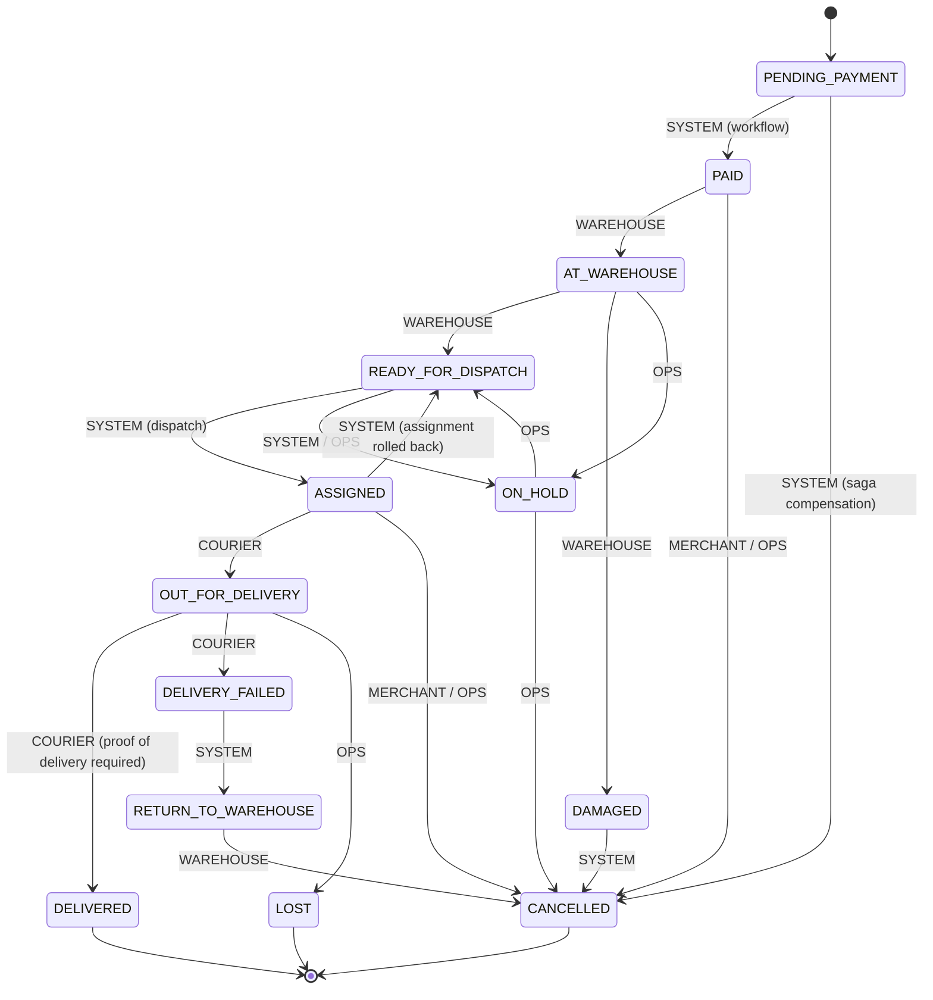
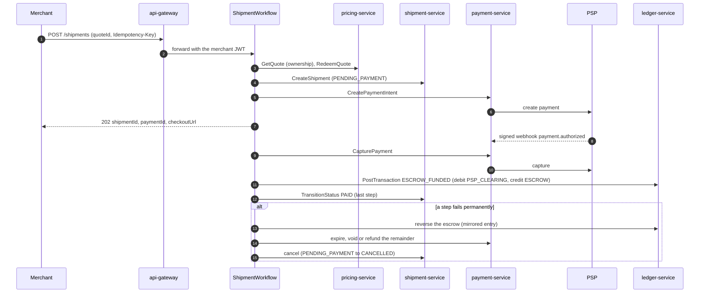
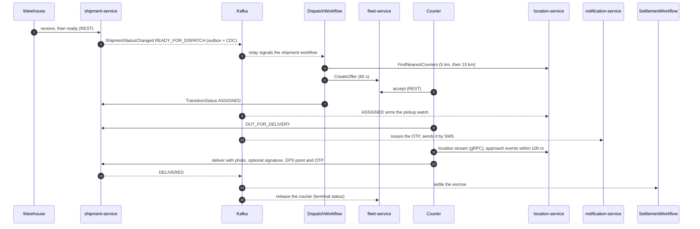
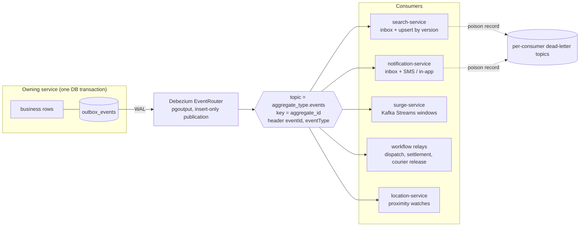
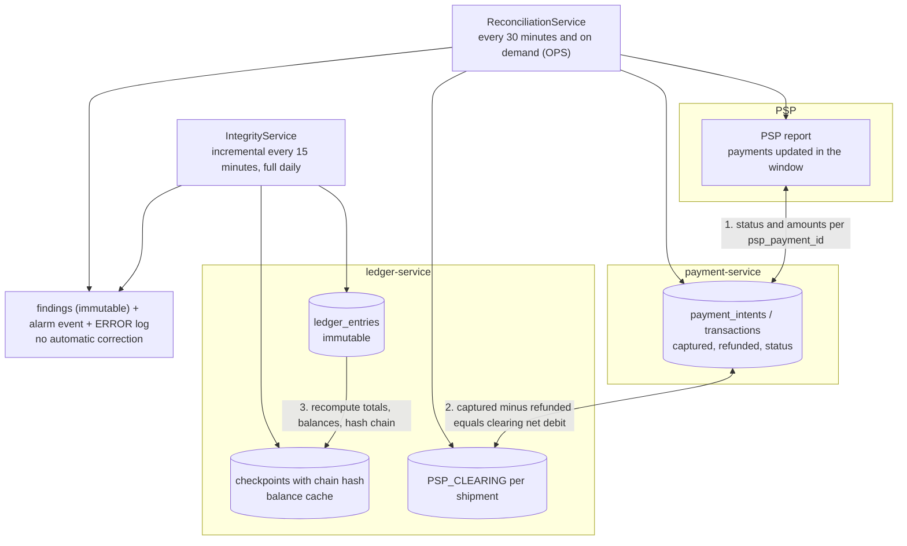

# RouteMesh

**A distributed logistics and financial settlement platform.** Merchants hand parcels to a warehouse, couriers deliver
them with proof of delivery, and every kuruş of the payment is tracked from the PSP to the wallets of the merchant, the
courier and the platform through an immutable double-entry ledger. It is built as twelve Spring Boot applications that
talk gRPC inside and REST outside, publish events through a transactional outbox, orchestrate long-running work with
Temporal sagas and keep each other honest with automated integrity audits and a three-way reconciliation.

[](https://github.com/erkutoguz/routemesh/actions/workflows/ci.yml)
[](https://github.com/erkutoguz/routemesh/actions/workflows/e2e.yml)

- **Correctness first.** Money is `long` kuruş in a single currency (`TRY`). Ledger, status history and proof of
  delivery are append-only, enforced by database triggers. Every write command is idempotent.
- **Zero trust.** Every service validates the caller's JWT itself; the gateway never mints or rewrites an identity.
- **Provable.** Twelve services start from a clean checkout with one command and a 22-step end-to-end smoke test
  walks a shipment from quote to wallet payout, checking every hop.
- **Operable.** Prometheus metrics (`routemesh_*` business meters), OpenTelemetry traces in Tempo, three Grafana
  dashboards, alert rules and an [operations runbook](docs/runbook.md).

## Contents

1. [Architecture](#architecture)
2. [Service catalog](#service-catalog)
3. [Key flows](#key-flows)
4. [Security and integrity guarantees](#security-and-integrity-guarantees)
5. [Quickstart](#quickstart)
6. [Web console](#web-console)
7. [Testing, CI and numbers](#testing-ci-and-numbers)
8. [Observability](#observability)
9. [Repository layout](#repository-layout)
10. [Documentation](#documentation)
11. [Known limitations](#known-limitations)

## Architecture



Everything between services is either a gRPC call (commands, always the `WORKFLOW` service role) or a Kafka event
(facts). Kafka never carries commands. State changes only enter Kafka through the outbox of the service that owns them
(the one exception is the Redis-backed `location-service`, which has no relational store and writes its own events).

## Service catalog

Twelve applications and three shared modules. Ports are the in-network ports; with the `apps` profile only the
gateway (8080), Keycloak (8180) and the PSP simulator (8085, demo use) are published to the host, plus the web console (3001) with
the `web` profile. Every published port
except the gateway's binds to `127.0.0.1` only. In the `prod`/`production` profile payment-service and shipment-service refuse to
start while the PSP webhook secret, the OTP secret or the object-store secret still has its development default.

| Service | HTTP | gRPC | State | Who may call it | Responsibility |
|---|---|---|---|---|---|
| `api-gateway` | 8080 | - | none | any valid JWT (ops routes need `OPS`) | Spring Cloud Gateway (Server MVC). Routes by path, forwards the `Authorization` header untouched. Never derives identity. |
| `shipment-service` | 8082 | 9092 | Postgres `shipment` (+ PostGIS), MinIO bucket `routemesh-pod` | REST: `MERCHANT` `COURIER` `WAREHOUSE` `OPS` per endpoint; gRPC: `WORKFLOW` | 13-state machine stored as data, immutable history, warehouse receive/ready (bulk), proof of delivery, HMAC-protected delivery OTP, outbox. |
| `payment-service` | 8084 | 9095 | Postgres `payment` | gRPC: `WORKFLOW`; webhook: HMAC; `/api/v1/ops/payments/**`: `OPS` | Payment intent lifecycle (authorize, capture, refund, void, expire), three idempotency layers, signed PSP webhooks, PSP reconciliation, outbox. |
| `psp-simulator` | 8085 | - | in memory | none (a fake PSP) | Signed webhooks with retry, reports endpoint, fault injection and tampering for reconciliation tests. |
| `workflow-service` | 8086 | - | Temporal | REST: `MERCHANT` (create shipment); calls others with a `WORKFLOW` service account | `ShipmentWorkflow` saga, `DispatchWorkflow`, `SettlementWorkflow`; Kafka relays that start or signal workflows; courier release. |
| `fleet-service` | 8087 | 9096 | Postgres `fleet`, Redis | REST: `COURIER`; gRPC: `WORKFLOW` | Courier status, assignment offers, Redis lock + DB row lock + fencing token, one active shipment per courier, outbox. |
| `location-service` | 8089 | 9090 | Redis; writes Kafka directly | gRPC: `COURIER` stream, `WORKFLOW` search; SSE: `MERCHANT` | Ordered telemetry ingest (Lua), nearest-courier search, 100 m approach events, live tracking over SSE. |
| `ledger-service` | 8090 | 9091 | Postgres `ledger` | gRPC: `WORKFLOW`; wallets: `MERCHANT` `COURIER`; ops: `OPS` | Immutable double-entry ledger, balance cache, wallets, integrity checkpoints and audits, outbox. |
| `surge-service` | 8091 | - | Kafka Streams state, Redis | consumes events; calls pricing as a `WORKFLOW` account | Per-zone supply/demand windows, damped surge multiplier published to Redis. |
| `search-service` | 8092 | - | Postgres `search` | `MERCHANT` `OPS` `WAREHOUSE` | CQRS read model of shipments with keyset pagination. |
| `notification-service` | 8093 | - | Postgres `notification` | `MERCHANT` `COURIER` | Inbox-protected consumer, in-app notifications, SMS (simulated), OTP delivery, dead-letter topics. |
| `pricing-service` | 8094 | 9093 | Postgres `pricing` (+ PostGIS), Redis | gRPC: `WORKFLOW` | Zone geofencing (`ST_Covers`), rate cards, integer basis-point pricing, single-use quotes. |
| `contracts` | - | - | - | - | Protobuf services and the versioned event envelope records. |
| `platform-security` | - | - | - | - | JWT/JWKS resource server auto-configuration, gRPC role lock, `TestJwts` for tests. |
| `platform-observability` | - | - | - | - | Kafka event-id span attribute, actuator observation filter. |

Infrastructure (all pinned, none `latest`): PostgreSQL 16 with PostGIS 3.7, Redis 8.10.3, Kafka 4.4.0 (KRaft),
Debezium 3.7.1, Temporal 1.29.7 (SDK 1.30.1), Keycloak 26.8.2, MinIO (Chainguard build, digest pinned), Prometheus
3.5.0, Tempo 2.8.2, Grafana 12.1.1. Java 21, Spring Boot 4.1.2, gRPC 1.84.1.

## Key flows

### Shipment lifecycle



`LOST` is reachable from every non-terminal state by `OPS`. The legal edges, the actor allowed to take them and whether
proof is required live in the `shipment_transitions` table, not in code, and a database trigger rejects anything else.
Only `SYSTEM` edges are reachable over gRPC; every human actor comes in through REST with their own token.

### Saga orchestration with Temporal

`POST /api/v1/shipments` starts `ShipmentWorkflow` (id `shipment-<uuid derived from merchant and Idempotency-Key>`).
The call answers as soon as the checkout is ready, the rest runs durably in Temporal.



Idempotency keys are `workflowId:operation`, so a retried activity or a compensation replays the original result and
never doubles a side effect. After `PAID` the workflow stays open and a child `DispatchWorkflow` runs each time the
shipment becomes `READY_FOR_DISPATCH`.

### Dispatch, delivery and courier release



### Outbox, CDC and the event consumers



- A service never writes to Kafka itself: the event is inserted into `outbox_events` in the same transaction as the
  state change, so there is no dual write. Debezium reads the WAL, so there is no polling relay. Rows are deleted after
  seven days; deletes are not published.
- Consumers that have side effects (`search-service`, `notification-service`) record the `eventId` in a
  `processed_events` inbox in the same transaction as the effect: a redelivery is a no-op, a failure rolls everything
  back and is retried with exponential backoff, and a record that can never succeed goes to the consumer's dead-letter
  topic (`<topic>.<consumer>.dlt`).
- `surge-service` turns fleet status, courier positions and new shipments into a per-zone multiplier with Kafka
  Streams (see [ADR-0009](docs/adr/0009-kafka-streams-and-postgis-for-surge.md)).

### Money: settlement, penalties and the three-way reconciliation

When a shipment ends, `SettlementWorkflow` posts one balanced journal transaction to the ledger. The split is integer
arithmetic with the remainder going to the platform (1001 kuruş becomes 750 / 180 / 71).

| Outcome | Ledger effect | Customer refund |
|---|---|---|
| `DELIVERED` | Escrow is split: 75 % merchant wallet, 18 % courier wallet, rest platform fee | none, or the SLA penalty |
| SLA breach | For every started 15 minutes late, 1.8 % of the amount moves from the platform fee back to the customer, capped at the platform's share (STANDARD 4 h, EXPRESS 2 h, clock `AT_WAREHOUSE` to `DELIVERED`) | the penalty, as a PSP refund |
| Return (`RETURN_TO_WAREHOUSE` to `CANCELLED`) | Courier keeps 18 %, platform 7 % | 75 % |
| `LOST` | Platform pays the merchant 75 % from `EXPENSE:LOST_COMPENSATION` | 100 % |
| Cancel before delivery | nothing is distributed | 100 % |



Neither audit ever changes a payment or a ledger row. A finding is evidence for a human (see the
[runbook](docs/runbook.md)); corrections are explicit reversing entries or PSP-side actions.

## Security and integrity guarantees

| Guarantee | How it is enforced |
|---|---|
| Zero-trust identity | JWT is validated by every service (signature via JWKS, `iss`, `aud=routemesh-api`, expiry). The gateway only routes. Services never read identity from forwarded headers. |
| Service-to-service lock | Every gRPC method requires the `WORKFLOW` role (client-credentials token, refreshed 30 s before expiry); `location-service` is the one service with its own rule (couriers stream their own position). |
| RBAC plus ownership | Role checks on every endpoint. Ownership comes from the token subject (`merchant_id`, `courier_id`, wallet account code, notification recipient), never from a request parameter. Someone else's resource answers `404`, so existence does not leak. |
| No PII or OTP leakage | The delivery OTP exists only as `HMAC-SHA256(server secret, shipment:code)` in the database and as a local variable on its way to the SMS channel: it never enters Kafka, a column, a log or a notification row (the development-only SMS sink file is the one explicit exception and is refused under a `prod` profile). Phone numbers are masked in logs and absent from `notifications.params`. Alarm events (integrity, reconciliation) carry types and counts only. |
| Proof of delivery within 50 m | Delivery inserts the proof with `INSERT ... SELECT ... WHERE ST_DWithin(delivery point, reported point, 50)` in the same transaction as the `DELIVERED` transition; a `CHECK (distance_meters <= 50)` backs it up. A far-away courier cannot burn OTP attempts (distance is checked first). |
| Append-only records | Triggers reject `UPDATE`, `DELETE` and `TRUNCATE` on ledger entries, status history, proof of delivery, findings and checkpoints. Corrections are reversing entries. Runtime database roles hold column-level grants only. |
| Double entry | Every journal transaction balances (debits equal credits), accounts that must not go negative are guarded under per-account advisory locks, reversals must mirror the original. |
| Gap-free audit | `ledger_entries.id` is an identity column, so a lower id can commit after a higher one. Writers hold a shared advisory lock on a gate key; the checkpoint takes it exclusively, so the scan never skips an in-flight write ([ADR-0010](docs/adr/0010-advisory-lock-gated-ledger-checkpoints.md)). |
| Tamper evidence | Each checkpoint stores `sha256(previous hash, entries)`; the daily full audit recomputes the chain from genesis and flags `HISTORY_TAMPERED`. |
| Idempotency | Every command carries a key: same key and same content replays the first result, same key and different content is a conflict. Webhooks are deduplicated by the PSP event id, PSP calls carry their own idempotency key. |
| Least privilege | Two database roles per service (`<service>_owner` for Flyway, `<service>_app` at runtime), a MinIO user that can read and write one bucket but not delete, and containers that run as a non-root user. |

## Quickstart

Prerequisites: Docker with about 9 GB of memory for the full stack (the twelve JVMs are limited to 512 MB each),
JDK 21 and Maven only if you want to run the tests.

```bash
git clone https://github.com/erkutoguz/routemesh.git
cd routemesh/docker

# 1. infrastructure only: Postgres, Redis, Kafka, Debezium, Keycloak, Temporal, MinIO
docker compose up -d --wait

# 2. the whole platform: adds the twelve applications and registers the Debezium connectors
docker compose --profile apps up -d --wait

# 3. add Prometheus, Tempo and Grafana
docker compose --profile apps --profile observability up -d --wait

# 4. the web console on http://localhost:3001 (needs the apps profile; add it to the same command)
docker compose --profile apps --profile web up -d --wait

# 5. the 22-step end-to-end smoke test (starts the stack by itself; no Tempo here, so disable trace export)
TRACING_EXPORT=false docker compose --profile e2e run --rm e2e
```

The images are built from one shared multi-stage `docker/service.Dockerfile` (BuildKit Maven cache, layered jars,
non-root runtime, actuator health checks); the first build takes a few minutes.

| What | Where |
|---|---|
| Web console | http://localhost:3001 (sign in as `merchant`, `warehouse`, `courier` or `ops`) |
| API gateway | http://localhost:8080 |
| Keycloak | http://localhost:8180 (realm `routemesh`) |
| PSP simulator | http://localhost:8085 |
| Grafana | http://localhost:3000 (`admin` / `admin`) |
| Prometheus | http://localhost:9099 |
| Temporal UI | http://localhost:8088 (namespace `routemesh`) |
| MinIO console | http://localhost:9101 |

Development users (password `<name>-dev`, fixed ids `00000000-0000-4000-8000-00000000000{1..4}`): `ops`, `merchant`,
`courier`, `warehouse`, through the public client `routemesh-web` (password grant is enabled for development only).
Service accounts are `workflow-service`, `payment-service`, `location-service`, `surge-service`,
`notification-service` and `search-service`; the first five carry the `WORKFLOW` role.

```bash
# a merchant token, then a call through the gateway
TOKEN=$(curl -s http://localhost:8180/realms/routemesh/protocol/openid-connect/token \
  -d grant_type=password -d client_id=routemesh-web -d username=merchant -d password=merchant-dev | jq -r .access_token)
curl -s -H "Authorization: Bearer $TOKEN" http://localhost:8080/api/v1/wallets/me
```

The end-to-end test (`docker/e2e`) runs preflight checks (service accounts get tokens, the four Debezium connectors are
running, Kafka topics were created by the compose dependency) and then the happy path: quote, shipment, PSP payment and webhook, warehouse receive and
ready, automatic assignment, live tracking over SSE with approach events, OTP read from a development-only SMS sink file,
50 m proof of delivery (a too-far attempt is rejected first), the 75 / 18 / 7 settlement checked against wallet deltas and
the ledger, the search read model, notification inboxes and finally the courier being released. Each step prints
`PASS` or `FAIL` with its duration, the first failure skips the rest and sets a non-zero exit code. The same test runs
nightly and on demand in GitHub Actions (`.github/workflows/e2e.yml`).

Notes for local runs: Keycloak imports its realm only on the first start of a fresh database; see the
[runbook](docs/runbook.md#1-keycloak-realm-re-import) to change or re-import it. The SMS sink file
(`routemesh.notification.sms.sink-file`) writes OTP codes in clear text and refuses to start under a `prod` profile.

## Web console

The RouteMesh Console (`web/`) is a Next.js, TypeScript and Tailwind app that signs in through Keycloak with
Authorization Code + PKCE and sends each user to the console of their realm role. It talks to the gateway directly with
the user's own token; there is no backend-for-frontend ([ADR-0014](docs/adr/0014-web-console-oidc-pkce-and-fetch-sse.md)).

| Role | Console | What it does | Main endpoints |
|---|---|---|---|
| `MERCHANT` | `/merchant` | Price a shipment, create it with an idempotency key, pay through the PSP simulator, keyset-paged shipment list, live map over SSE with the 50 m geofence ring and approach banners, wallet balance and ledger entries | `POST /api/v1/quotes`, `POST /api/v1/shipments`, `GET /api/v1/search/shipments`, `GET /api/v1/tracking/{id}/stream`, `GET /api/v1/wallets/me` |
| `WAREHOUSE` | `/warehouse` | Shipments waiting for the warehouse, receive and mark ready | `GET /api/v1/warehouse/shipments`, `POST /api/v1/warehouse/shipments/{id}/receive` and `/ready` |
| `COURIER` | `/courier` | Go online, accept or reject offers, send GPS pings (depot, 120 m, 15 m, map click), depart, deliver with photo, signature and OTP; the 50 m rule shows as a `422` | `/api/v1/fleet/me/**`, `POST /api/v1/couriers/me/location`, `POST /api/v1/shipments/{id}/deliver` |
| `OPS` | `/ops` | Reconciliation summary, manual run (`202`), filtered findings; ledger integrity summary, checkpoint, incremental check and full audit | `/api/v1/ops/payments/reconciliation**`, `/api/v1/ops/ledger/**` |

Beyond the API surface that already existed, the console needed two thin REST endpoints over existing service logic
(`POST /api/v1/quotes` in `pricing-service` and `POST /api/v1/couriers/me/location` in `location-service`), a CORS
configuration for the web origin in the gateway, and a `S256` PKCE rule on the `routemesh-web` client. The `web` Compose profile builds
`web/Dockerfile` (pinned Node 22 Alpine, standalone output, non-root, health check); see [web/README.md](web/README.md) for
development and the Keycloak notes.

## Testing, CI and numbers

Every module is built and tested from the repository root with `mvn verify`. Tests run against real infrastructure
through Testcontainers (PostgreSQL with PostGIS, Redis, Kafka, MinIO, the Temporal test server); the database rules,
triggers, advisory locks and Lua scripts are exercised on the real thing, not mocked.

| Module | Tests |
|---|---:|
| `api-gateway` | 24 |
| `shipment-service` | 133 |
| `payment-service` | 186 |
| `psp-simulator` | 24 |
| `workflow-service` | 160 |
| `fleet-service` | 48 |
| `location-service` | 123 |
| `ledger-service` | 112 |
| `surge-service` | 54 |
| `search-service` | 33 |
| `notification-service` | 47 |
| `pricing-service` | 73 |
| `platform-security` | 6 |
| `platform-observability` | 8 |
| **Total** | **1031** (0 failures; `contracts` has no tests of its own) |

The web console adds 57 Vitest unit tests (money formatting, the SSE parser and reconnect loop, the API client, return-path
safety, geodesy, tracking events and the typed endpoint modules) next to `eslint`, `tsc` and `next build`. The Java counts above are from the
document's original run; the gateway, pricing and location suites have grown since the REST endpoints for the console were added.

At a glance: 15 Maven modules (12 applications and 3 shared modules), 6 protobuf services with 25 RPCs, 21 Flyway
migrations, 4 Debezium outbox connectors, 6 Kafka topics plus per-consumer dead-letter topics, about 16.7 thousand lines
of production Java in 316 files, 3 Grafana dashboards, 8 alert rules and 14 ADRs.

- **CI** (`.github/workflows/ci.yml`): one job per module (`Test <module>`) plus `Test web` (lint, type check, unit tests,
  build) on every pull request and push to `main`, and a single required `CI passed` check that summarizes them.
- **End-to-end** (`.github/workflows/e2e.yml`): builds all twelve images, starts the whole platform with Docker Compose
  and runs the 22-step smoke test, nightly and on demand (never per pull request: it is the heavy one). Container logs
  are uploaded as an artifact on failure.
- Counts were taken from a clean `mvn clean verify` on the commit that introduced this document.

## Observability

- **Metrics.** Every application serves `/actuator/prometheus` (unauthenticated; none is published to the host: the gateway serves its actuator on the unpublished management port 8079). Business meters are
  prefixed `routemesh_` and never use an unbounded value as a label (no shipment, user or payment ids): shipment and
  payment transitions, proof-of-delivery outcomes, webhook outcomes, PSP call latency, workflow starts and results,
  settlement postings, ledger checkpoint lag, integrity and reconciliation runs and findings, dead-letter counts,
  surge multiplier per zone.
- **Traces.** OpenTelemetry to Tempo over OTLP HTTP. One trace follows a shipment request from the gateway through the
  workflow, the Temporal activities (trace context crosses Temporal through `temporal-opentracing`) and the gRPC
  calls to the PSP simulator. Kafka consumers start a new trace per event and carry the outbox `eventId` as the span
  attribute `routemesh.event.id`.
- **Dashboards.** `RouteMesh - Platform RED and JVM`, `RouteMesh - Business Flow` and
  `RouteMesh - Financial Integrity and Reconciliation`, provisioned from `docker/observability/grafana`.
- **Alerts.** `docker/observability/prometheus/rules.yml`: service down, high 5xx rate, ledger checkpoint lag, ledger
  integrity violation or failed run, reconciliation discrepancies or staleness, dead-letter growth. There is no
  Alertmanager; rules are visible in Prometheus and Grafana.

## Repository layout

```text
.
├── contracts/                 protobuf services and event envelope records
├── platform-security/         JWT resource server + gRPC role lock + test support
├── platform-observability/    observation filters shared by the applications
├── api-gateway/ shipment-service/ payment-service/ psp-simulator/ workflow-service/ fleet-service/
│   location-service/ ledger-service/ surge-service/ search-service/ notification-service/ pricing-service/
├── web/                       RouteMesh Console: Next.js app, Vitest tests, Dockerfile
├── docker/
│   ├── docker-compose.yml     infra (default), apps, web, observability, e2e profiles
│   ├── service.Dockerfile     shared build for the twelve applications
│   ├── debezium/              outbox connector definitions
│   ├── keycloak/              realm export and image
│   ├── postgres/init/         databases, roles, extensions
│   ├── observability/         Prometheus, Tempo, Grafana provisioning and dashboards
│   └── e2e/                   smoke test runner image and scripts
├── docs/
│   ├── adr/                   architecture decision records
│   └── runbook.md             operations runbook
└── .github/workflows/         per-module CI matrix and the nightly E2E
```

## Documentation

- [Architecture decision records](docs/adr/README.md): fourteen decisions, each with context, the choice and its
  consequences.
- [Operations runbook](docs/runbook.md): Keycloak realm re-import, dead-letter topics, ledger integrity audits,
  reconciliation findings and other first-response procedures.

## Known limitations

This is a complete reference implementation, not a production offering. What it deliberately does not do:

- The PSP is a simulator; there is no real card network connector and no payout of wallet balances.
- One warehouse (coordinates in configuration), straight-line distances instead of road routing, one courier leg per
  shipment, no automatic re-delivery after `DELIVERY_FAILED`.
- Every piece of infrastructure runs as a single node (Kafka, Postgres, Redis, Temporal, Keycloak); multi-instance
  behaviour of the services was designed for (leases, unique running-run indexes, partitioned streams) but is covered by
  tests rather than by a multi-node deployment.
- Trace context does not cross the outbox boundary (Debezium does not carry it), so a consumer's trace is linked to its
  producer by `routemesh.event.id`, not by a parent span.
- Failed consumer records are routed to dead-letter topics but there is no replay tool; the runbook describes the
  manual procedure.
- Reconciliation and integrity audits report only; nothing is corrected automatically ([ADR-0011](docs/adr/0011-three-way-reconciliation-without-auto-correction.md)).
- The `OFFERED` assignment offers of a cancelled shipment expire by their own timer instead of closing immediately.
